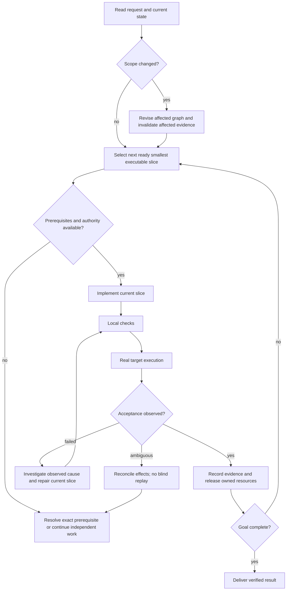

# Operating algorithm

## Algorithm format
Use the project's existing format, preferably a short Markdown table plus a Mermaid flowchart. A simple task needs a simple diagram. Required facts (not new paperwork): goal and acceptance, current revision, owner, ordered nodes and dependencies, next slice, observed state, real evidence link, blocker and next action. Detail each executable node with input, preconditions, effect, target, expected observation, recovery and stop conditions. Decisions must have named branches; loops must have an attempt/time budget and a changed-hypothesis requirement. An input receipt is not an executed effect.

## Dynamic revisions
On a new user request: capture the request source/time, update goal/non-goals and affected nodes, preserve unchanged verified nodes, invalidate evidence for changed code, contract, dependency or target, then choose the next ready slice. Do not silently retain “done” after its acceptance criterion changes. A new owner reads only the compact current handoff and needed linked evidence. Preserve obsolete decisions as short history, not executable backlog.

## Real-test contract
Before coding, specify the supported product entry point, actual environment/device/service, expected user-visible or machine-observable result, safe test data, and cleanup. Identify which assertions local tests cover and which require real execution. An integration test against a fake server remains synthetic. For a library, real use through its public API in its intended runtime can be the target; desktop clicks are not universally required. For this skill, actual helper execution and independent behavioral evaluations are distinct evidence categories, not proof of performance in every future project.

If access is missing: attempt only already-authorized supported preparation, distinguish an unmet prerequisite from a denial, and give the precise missing action. Never treat UNKNOWN as zero, safe, successful, forbidden, or permission. Use the user's actual budget/stop rules, not hardcoded account thresholds. A real service refusal stops the affected operation.

## Optional machine-readable plan
Use only if helpful; do not create a second ledger beside an existing canonical state. `validate` reads this optional JSON without changing it:

- `revision`: non-empty string; `goal`: non-empty string.
- `nodes`: array, each `id`, `owner`, `depends_on` (IDs), `status` (`planned`, `active`, `blocked`, `verified`), `acceptance`, `target`, `revision`.
- A verified node needs `evidence`: `kind: real`, `result: pass`, matching `revision`, matching `target`, non-empty `reference`, ISO `observed_at`.
- Active/verified nodes require verified dependencies. At most one active critical-path node. All nodes here describe the serial critical path, not independently parallel helpers.
- `next`: ID of the active or planned ready node; null only if all verified or every unfinished node is blocked/dependent on blocked work.

The helper rejects malformed graphs, cycles, incomplete/stale evidence metadata and advancing past an unverified dependency. It cannot tell whether evidence is truthful or sufficiently fresh for a changed external environment. The owner must inspect the referenced artifact and current conditions.

## Optional cooperative continuity helpers

`scripts/claim_guard_8d31f72a.py` exposes `claim(project, slice_id, files)` as a context manager. A participant holds nonblocking OS locks for the slice and its project-relative file paths for as long as its process holds the handles. All writers must participate with the same identities; it cannot restrain another program. A conflict raises `ClaimBusyError`, while other access failures propagate. Fixed persistent guard stripes keep coordination storage bounded; collisions can conservatively report busy. The helper never deletes guards or treats a PID, timeout or age as proof of release. A crash releases its OS handles but the new owner must reconcile partial product effects before resuming. An unknown or incompletely initialized guard is preserved for inspection. Path checks reduce accidental escapes but do not defeat hostile concurrent filesystem replacement.

`scripts/continuity_plan_64e9b1c2.py` exposes the read-only `evaluate(root, plan, previous, observed, stopped=..., denied=...)` API. Each node describes its id, owner, file owners, contract, input and output paths, dependencies, target and target SHA-256 expectation. The helper checks a dependency graph, reads actual project files, calculates deterministic fingerprints, reuses matching file observations and lists ready nonconflicting nodes. A changed file, contract or dependency invalidates affected file observations. A STOP halts the evaluation; explicitly denied node IDs and their dependents are blocked while independent nodes remain eligible. The caller must carry forward the actual scope of a refusal and must not retry or re-express it under another identity.

These are file-state observations, not evidence that code executed, that an expected hash is correct, or that submitted prior evidence or authorizations are authentic. A target file match cannot by itself mark product behavior complete or authorize the next product-dependent slice. The owner performs and records the actual target acceptance test separately. The helpers do not schedule agents, enforce ownership for nonparticipants, resume a turn, or replace the canonical project record.
